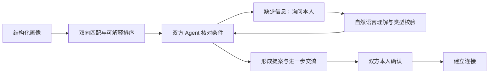

# X-Agent

### 让 Agent 先聊，让人与人相遇

你的 AI 已经很懂你，这份理解可以成为一次相遇的起点。

X-Agent 是一款基于 Agent-to-Agent 的社交应用原型：从个人画像出发，发现契合的人，让双方 Agent 先交流；遇到未知偏好，回到本人询问，再带着补充继续沟通。最终，只有双方本人同意，才建立连接。

**把重复的试探交给 Agent，把相遇的决定留给你。**

[网页 Playground](https://untrall.github.io/x-agent/?auto) · [完整流程与操作说明](docs/combined-flow.md) · [对话样例](docs/combined-dialogue-sample.md) · [协商内核文档](docs/implementation/mvp/README.md)

> 为 2026 张江校友 Hackathon 构建。当前主 Demo 为交友场景，同时保留合伙人与场地协商配置，用于探索通用的人与 Agent 协作框架。在线 Playground 展示第一幕；完整的四 Agent 交互需要在本地启动。

## 一次完整的演示

| 阶段 | 你会看到什么 |
|---|---|
| 画像与匹配 | 网页管理员视角展示画像、硬条件过滤、双向契合分和匹配理由 |
| 偏好反馈 | “太安静了”的反馈更新排序，星图同时高亮陈语桐、方糖、林小满，引导进入下一幕 |
| Agent 先聊 | 切换到四个独立 TUI，阿哲与三位交流对象的 Agent 通过 HTTP 核对条件 |
| 本人补充 | Agent 询问“进入稳定关系后是否愿意在同一个城市长期生活？”，本人用自然语言回答，补充后恢复协商 |
| 进一步了解 | 提案形成后，阿哲可以向对方的 Agent 提问，了解对方画像中的兴趣与期待 |
| 双向确认 | 阿哲选定一位，对方本人接受后建立连接；对方也可以婉拒 |

“当前同城”与“未来愿意长期同城生活”是两个独立字段，后者初始为待确认。主角的回答用于补充本轮要求，对方的回答用于确认自己的事实；不确定的回答会触发澄清，回答本身不会自动批准提案。

## 快速开始

在仓库根目录运行。需要 **Python 3.12+、uv、tmux**；本地分屏演示使用 Bash，已在 macOS 验证。

```bash
uv sync --group dev
# macOS 尚未安装 tmux 时：
brew install tmux
```

### 1. 配置模型

自然语言补问和画像聊天使用 OpenAI 兼容的 Chat Completions 接口。设置自己的服务地址、模型与密钥：

```bash
export LLM_BASE_URL=https://sem.ensureok.ai/v1
export LLM_MODEL=glm-5.2
export LLM_API_KEY='<your-api-key>'
```

也可以在 macOS 钥匙串中保存密钥，由启动脚本读取。运行下列命令后按提示输入：

```bash
security add-generic-password -a "$USER" -s x-agent-llm -w
```

`scripts/with_llm_env.sh` 优先使用已有的 `LLM_API_KEY`，否则读取钥匙串。服务地址和模型可通过上述环境变量覆盖。密钥不需要写入 Agent 配置或仓库。

### 2. 启动完整演示

```bash
bash scripts/demo_tui.sh
```

脚本生成本轮配置和数据库，启动四个 TUI 与本地网页服务，并打印网页地址。端口自动分配，使用终端实际输出的地址。交互式 macOS 终端会尝试自动打开网页。

1. 网页自动播放第一幕，展示画像、匹配与反馈。
2. 回到终端底部提示栏，按 **Enter** 开始第二幕。
3. 需要本人补充时，焦点会切换到对应窗口。用自己的话回答，再按 **Enter** 提交。例如：“我希望稳定后能在同一个城市生活，也希望对方有这个打算。”
4. 提案到齐后，在阿哲窗口选择交流对象并输入问题；也可以使用 `@陈语桐 你周末一般怎么过？`。
5. 点击“选定”或输入 `/choose 陈语桐`，由对方本人在自己的窗口接受或婉拒。

```bash
# 分离终端后重新进入
tmux attach -t xagent-demo

# 完全结束本地演示
tmux kill-session -t xagent-demo
```

按 **Ctrl+B，再按 D** 只分离终端，演示继续运行。重新执行启动命令会重建名为 `xagent-demo` 的演示会话。

### 3. 自动演示与重置

```bash
# 网页第一幕结束后仍需按一次 Enter；随后脚本自动代答、提问和确认
bash scripts/demo_tui.sh --auto-chat

# 放慢第二幕操作，便于讲解
bash scripts/demo_tui.sh --auto-chat --delay 3
```

自动模式使用明确的演示预设回答，并默认选择排名第一的交流对象；它用于录屏和流程验证。默认交互模式由本人回答和批准。

本地网页右上角的 **“重置”** 会让网页、四个 TUI 和演示驱动一起回到开始状态。网页地址和终端布局保留，新的运行使用独立配置、端口和数据库；旧记录保留在 `.local/combined/`。重置完成后，点击网页“自动演示”重新播放，再在终端按 Enter 开始第二幕。

GitHub Pages 或普通静态服务器没有 TUI 控制能力，其重置按钮只重置网页。

## 其他运行方式

### 仅看网页，无需模型

```bash
python3 scripts/build_demo_data.py
python3 -m http.server 8080 --bind 127.0.0.1 --directory demo
```

打开 [本地网页演示](http://127.0.0.1:8080/?auto)。第一幕使用合成画像与预设问答，分数由实际匹配引擎计算。

### 无界面的完整协商验证，无需模型

```bash
uv run python scripts/run_combined.py --delay 0
```

启动四个真实 Agent 进程，通过规则策略和脚本代答走完协商，输出路径位于 `.local/combined/<user>-<timestamp>-<id>/`：

- `TRANSCRIPT.md`：事件记录。
- `DIALOGUE.md`：面向演示的对话视图。
- `result.json`：会话结果与快照。
- 每个 Agent 的配置、SQLite 数据库和日志。

带真实模型聊天的无界面演示：

```bash
bash scripts/with_llm_env.sh .venv/bin/python scripts/run_combined.py --auto-chat
```

### 单独启动 Agent

```bash
uv run python scripts/run_combined.py --configs-only
# 使用上一步输出的本轮配置路径
bash scripts/with_llm_env.sh .venv/bin/python scripts/run_agent.py \
  --config <本轮目录>/agent-1.json --answer-model
```

| 参数 | 用途 |
|---|---|
| `--answer-model` | 用模型理解本人自然语言回答，协商仍遵守规则与类型校验 |
| `--chat-model` | 提案阶段按本人的画像回答对方问题 |
| `--mode model` | 使用 HTTP 模型策略参与协商决策 |
| `--mode codex` | 使用本机已登录的 Codex CLI 策略 |
| 不加上述参数 | 离线规则模式；回答只接受明确的布尔值、数字等字段类型 |

一键演示已为四个 Agent 启用 `--answer-model`，为三位交流对象启用 `--chat-model`，无需手动追加。

## 技术设计



**匹配层**：先检查硬条件，再分别计算两个方向的需求覆盖、价值观、特质与兴趣分数，最终取调和平均。反馈可以改变显式偏好门槛并更新排序，每个分数附带解释。

**协商层**：每个 Agent 拥有独立的 HTTP 服务、SQLite、画像、待答问题和批准入口。补充信息后恢复原会话，提案通过双方确认后形成一致的结果。通用内核位于 `src/xagent/mvp/`，字段与补问由场景配置描述。

**模型层**：回答理解、画像聊天与协商策略分开。默认演示由模型理解自然语言、回答画像问题，规则负责状态转换。模型结果必须通过类型校验，无法确认时继续澄清。

**演示桥接层**：`run_combined.py` 将匹配结果转换为四个 Agent 的独立配置；演示驱动负责启动、视角切换和自动代答。Agent 间协商使用点对点消息。

## 当前实现与边界

- 主演示采用合成用户画像。第一幕的接入动画、问答和反馈为预设内容，尚未接入个人助手账号或实时记忆源。
- 画像蒸馏 CLI 可调用真实模型；“蒸馏 → 实时网页更新 → 自动重新匹配”仍待完整打通。
- Agent 通信使用项目自定义 HTTP JSON 协议，尚未实现标准 A2A 协议兼容。
- 原始聊天不进入匹配池数据结构；启用外部模型时，相关回答或画像上下文会发送到配置的模型服务。画像蒸馏不等于隐私保证。
- 当前 P0 支持针对待答问题的回答、澄清、恢复协商，以及提案阶段聊天与选择；开放式持续聊天、随时接受提案仍属后续工作。
- “建立连接”是本地演示的协商结果，不会向真实社交账号发送消息或安排线下见面。

## 代码与文档

| 路径 | 用途 |
|---|---|
| `demo/` | 第一幕网页、星图与匹配理由 |
| `core/`、`scenarios/` | 画像蒸馏、双向评分与匹配场景 |
| `data/personas.json`、`data/raw_logs/` | 合成画像与示例原始材料 |
| `src/xagent/mvp/` | 协商内核、HTTP、SQLite、模型适配与 TUI |
| `configs/mvp/dating-match.json` | 交友协商字段与“长期同城生活”补问 |
| `configs/mvp/` | 合伙人、场地等复用场景及示例配置 |
| `scripts/demo_tui.sh` | 网页 + 四 TUI 一键启动 |
| `scripts/demo_control.py` | 本地网页服务与联动重置 |
| `scripts/run_combined.py` | 匹配与协商桥接、自动演示与结果导出 |
| `tests/` | 内核、自然语言回答、TUI、跨进程与重置测试 |
| [完整演示流程](docs/combined-flow.md) | 参数、操作与两幕衔接 |
| [MVP 实现说明](docs/implementation/mvp/README.md) | 通用协商内核与其他场景 |
| [蒸馏评测](docs/live-distillation.md) | 已有真实模型画像蒸馏记录 |
| [调研资料](docs/research/2026-10-16/README.md) | 框架选型与可行性分析 |

### 画像蒸馏

配置前述 `LLM_*` 环境变量后：

```bash
bash scripts/with_llm_env.sh .venv/bin/python scripts/distill_persona.py \
  --raw data/raw_logs/azhe.md \
  --scenario scenarios/dating.json \
  --out /tmp/azhe_live.json
```

### 验证

```bash
uv run pytest -q
uv run python scripts/smoke_mvp.py
```

测试使用本地数据和模型替身，不调用真实模型服务。tmux 集成测试在独立 socket 中验证重置，不影响正在演示的会话。真实模型交互通过前述完整演示命令体验。

### 后续方向

真实个人 Agent / 记忆源接入、标准 A2A 适配、持续对话与偏好更新，以及更多场景的端到端复用验证。

## English

**X-Agent — Let agents talk first. Let people decide.**

A social application prototype where personal agents explore compatibility, ask their owners when information is missing, and resume the conversation with confirmed preferences. The hackathon demo connects a visual matching playground with four independent agent processes, natural-language owner input, and mutual approval. The negotiation core also includes cofounder and venue scenarios. The current transport is custom HTTP JSON; standard A2A interoperability is future work.

## License

MIT
