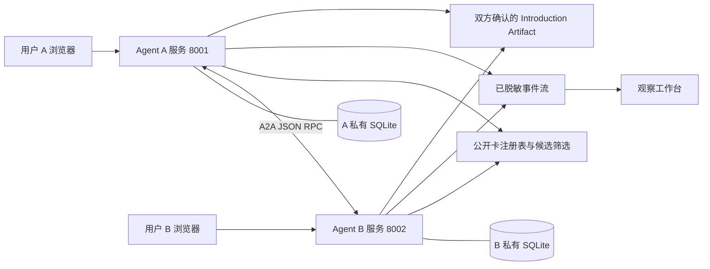
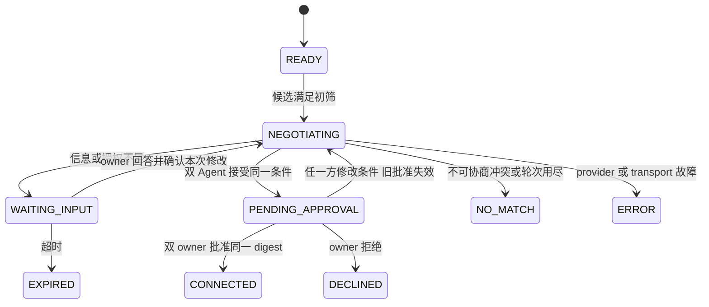

# X Agent 双边协商框架设计

## 目标与成功定义

用户创建自己的 Agent，输入事实、需求和授权边界。Agent 找到候选后交换结构化提案；不确定性返回对应用户；用户补充后更新本次会话条件并继续协商；两个人批准同一份结果后，系统生成可执行的介绍机会。

本稿是建议设计，服务于 2026-10-17 两人 Hackathon。主场景默认创业合伙人，辅场景为活动搭子。此轮交付是调研和规划，以下产品接口及文件尚未实现。

**五条验收主线：** A/B 独立运行、至少一次中途询问、同会话恢复、同版结果双确认、换场景配置仍通过同一契约测试。

## 最小产品形态

一个 Web 工作台、一个可复用 Python 核心、两个独立 Agent 服务、两份 scenario JSON、一套可重放且明确标识的演示数据。

Web 只需三个主要视图：

1. **我的 Agent**：输入/导入合成资料，预览事实与需求，区分硬约束/软偏好/需询问条件，并确认可公开字段。
2. **协商工作台**：A/B 两边的提案、当前条件差异、状态与轮次。用户问题在所属一侧突出显示。调试视图显示实际消息和会话 ID。
3. **结果卡**：共同目标、达成条件、仍需线下核实的自述信息、首次会面安排、双方批准记录、可分享字段。支持 JSON 下载；日历 ICS 为加分项。

UI 显示简短决策依据和证据字段，不公开模型内部思考链。中间面板默认只显示双方已经交换的内容；A 的私有底线只能在 A 的 owner 视图看到。

## 架构



一个 Python 程序以不同参数启动两份服务即可；不需要做两套代码。中央 API/UI 在 8000；它路由 owner 操作与聚合公开事件，不参与替 A/B 作决策。A/B 各自加载私有画像、独立模型上下文、独立数据库。允许共用模型 provider，但不能将双方私有画像拼进同一个决策 prompt。

注册表存储 `AgentCard + PublicProfile`。AgentCard 说明端点和技能；PublicProfile 说明用户允许发布的场景事实。不要把“知道用户的所有信息”塞进 AgentCard。

## 数据模型

| 对象 | 必需字段 | 设计约束 |
|---|---|---|
| `PrivateProfile` | owner_id、version、facts、requirements、disclosure、updated_at | 存在所属 Agent；事实标注 `user_confirmed / self_reported / inferred / unknown` |
| `Requirement` | id、field、operator、value、kind、source | kind 为 hard、soft、ask；hard 只有 owner 显式修改才能变化 |
| `PublicProfile` | agent_id、scenario_id、offers、needs、公开 facts | 从 allowlist 生成，不能从 private 对象整包序列化 |
| `Session` | id、revision、scenario_id、participants、profile_versions、state、rounds、proposal、pending_question、approvals | 同会话中 profile version 和 proposal version 独立递增 |
| `Question` | id、owner_id、field、options、reason_code、base_revision、scope | 本次范围默认为 session；同时只处理一个待答问题，支持顺序询问双方 |
| `Proposal` | version、terms、evidence、open_questions、digest | digest 用固定 JSON 规范化计算；术语值来自场景 schema |
| `Approval` | owner_id、proposal_digest、profile_versions、created_at、decision | 由 owner API 产生；Agent 的 accept 不等于 Approval |
| `IntroductionArtifact` | session_id、scenario_id、terms、consents、next_step、disclosed_fields | 双方同意后才能生成；仍是意向介绍，不是法律合同 |

画像中的每条推断都能被用户纠正。未知不能写成 false；自述经验不能标成已验证履历。用户回答新增偏好时默认只修改本次会话 overlay，只有用户选择“应用到未来匹配”才写全局 profile 并触发候选重排。

主场景示例：A 寻找有 AI 产品经验的商业合伙人，期望尽快全职，但标记“入职时间需我确认”；B 目前每周可投入 15 小时、90 天后全职。这样有真实协商空间。若 A 明确设置“30 天内全职，不可协商”，B 应被拒绝，不能靠 LLM 擅自放宽。

## 匹配与协商的分工

候选池使用 8–12 个合成资料；不需要 embedding 数据库。先以公开事实做确定性筛选，再对 Top 3 显示双向需求覆盖，正式协商一次只选一个候选。候选顺序稳定，平分按 agent_id 排序。

硬约束检查采用三值结果：`pass / fail / unknown`。只有明确 fail 立即排除；unknown 形成待核实项，不能当作 pass，也不能不问就淘汰。可协商条件进入协商阶段。

方向分数建议为 `fit(A needs, B offers)`；展示 A→B 和 B→A，不显示虚构概率。MVP 可使用已知项加权覆盖率，以 `min(A→B, B→A)` 作为排序指标，同时展示已知覆盖比例。未知项不算满足；空需求集合返回“信息不足”，不默认满分。匹配分只是启发式，无需在 Hackathon 声称经过实证验证。

协商围绕可检查的 terms，例如 `start_in_days`、`hours_per_week`、`ai_product_experience`、`first_meeting_slot`。模型选择提案和生成简短解释；规则层决定允许的字段、边界、状态转换和是否需要询问。

## 状态与恢复



任意非终态允许用户取消，进入 CANCELLED。CONNECTED、NO_MATCH、DECLINED、CANCELLED、EXPIRED 为不可变结果；新需求创建新的 session，可带 previous_session_id。ERROR 保留 checkpoint，显式重试，不悄悄重置整个匹配过程。

内部业务状态不是 A2A TaskState 的逐项复制。A2A 的一个协商 task 跨用户暂停保持未终结；缺少用户输入时映射 input-required；人类审批也可作为 input-required 中的一种 pending kind。只有产生连接结果或明确无匹配结果时 completed 并给出对应 artifact。业务 NO_MATCH 是成功处理的结果，通常不应误报传输 failed。

LangGraph 的 thread_id 固定为 session_id，SQLite 保存 graph checkpoint。中断节点恢复时可能重新执行节点前半段，因此发消息、写结果等副作用不能放在未去重的 interrupt 前。事件/消息使用幂等键，写入与 session revision 校验同一事务。SSE 页面刷新只读已保存事件，不再次启动模型调用。[interrupt 官方说明](https://docs.langchain.com/oss/python/langgraph/interrupts)。

## 业务消息封装

X-Agent 自定义业务内容通过 A2A 的结构化 Part 传输，不重新定义 A2A wire format。

```json
{
  "schema_version": "xagent.negotiation/0.1",
  "message_id": "m-004",
  "session_id": "s-001",
  "scenario_id": "cofounder.v1",
  "sender_agent_id": "agent-a",
  "recipient_agent_id": "agent-b",
  "expected_revision": 3,
  "proposal_version": 2,
  "type": "COUNTER",
  "terms": {"start_in_days": 90, "hours_per_week": 15},
  "reason_codes": ["OWNER_ALLOWED_DELAY"],
  "evidence_refs": ["public:experience.ai_product"]
}
```

支持六个模型动作：`PROPOSE`、`COUNTER`、`ASK_OWNER`、`ACCEPT`、`REJECT`、`REQUEST_INFO`。系统动作另有 `OWNER_RESPONSE`、`OWNER_APPROVAL`、`CANCEL`。模型不能产生 owner 操作，不能写 sender 权限、owner_id、批准记录或联系方式。

A2A task/context 和业务 session 的映射要保存。每个端点的 task_id 可以不同，session_id 是跨双方关联键。恢复时使用该端点原来的 task_id 和 context_id；业务不要求双方恰好使用同一个 A2A task_id。旧 revision 消息返回冲突；重复 message_id 返回已处理结果，不再扣轮次或调用模型。

## 对外接口与扩展点

| 接口 | 请求核心 | 结果/校验 |
|---|---|---|
| `POST /api/profiles/preview` | owner 输入、scenario_id | schema 校验后的待确认 profile，不立即发布 |
| `POST /api/profiles/confirm` | profile、expected_version、公开字段 | 更新所属 Agent 存储，生成公开投影 |
| `GET /api/candidates` | scenario_id，owner token 决定本人 | 双向覆盖、unknown、硬约束结果 |
| `POST /api/sessions` | candidate_agent_id、scenario_id | 创建 session 并返回首个状态 |
| `POST /api/sessions/{id}/answers` | question_id、answer、expected_revision、scope | 验证答题 owner、合法选项和版本，恢复图 |
| `POST /api/sessions/{id}/approvals` | proposal_digest、approve、expected_revision | 仅所属 owner；条件变化使旧 approvals 全部失效 |
| `POST /api/sessions/{id}/cancel` | expected_revision | 终止后不接受迟到消息 |
| `GET /api/sessions/{id}` | owner token | 授权范围内的状态和当前提案 |
| `GET /api/sessions/{id}/events` | Last-Event-ID | SSE，严格按 seq 回补已保存公开事件 |
| `GET /api/sessions/{id}/artifact` | owner token | 未双确认返回不可用；成功后 JSON |
| A2A Card 和 JSON-RPC | SDK 标准路由 | `/.well-known/agent-card.json`，固定协议版本 |

扩展接口控制在三个：`AgentPolicy.decide(context) -> Decision`、`Transport.exchange(peer, message) -> PeerReply`、`ScenarioSpec` 配置对象。OpenClaw/MCP 为后续输入适配器，明天不做完整插件生态。

ScenarioSpec 包含 facts/terms 的 JSON Schema、要求字段、允许操作符、硬约束表达式、评分权重、允许询问的选项、公开字段、结果模板。条件 DSL 只支持 eq、in、gte、lte、contains，禁止配置中任意 eval。第二场景超出这些操作符时，应扩展版本和契约测试，不宣称“任何场景零代码”。

## 授权、隐私与资源边界

本地演示使用预置 A/B owner token，后端从 token 解析 owner，不能相信前端传来的 owner_id。进程间密钥与 owner token 分开；模型工具没有批准权限。只允许配置中的 localhost 或明确登记端点，不让模型生成 URL 后任意请求。

同意绑定 `scenario_id + participants + proposal terms + profile_versions + disclosure scope` 的 canonical digest。任一条件或被批准画像版本变化，旧批准失效。使用事务保证两次并发批准只生成一份结果；任一用户拒绝则不披露联系方式。

私有字段按 allowlist 投影，而不是依靠 prompt“请别泄密”。模型生成的自然语言也可能包含私密信息：公共摘要优先由已通过 schema 的 terms 模板生成。Demo 使用合成数据，给双方各放一个不同 canary 私有标记，验证它们没有出现在对端请求或公共事件里。这个测试只证明所测路径，不宣称密码学隐私。

默认上限建议：每会话最多 6 次 Agent 决策、最多 2 次 owner 追问、单次模型 15 秒 timeout、无效结构最多一次修复。坏 JSON、超时和 provider 错误转为可解释错误，保留状态。模型调用计数、总 tokens 和 elapsed_ms 持久记录。真实成本依据现场 provider 价格计算，不能假设一个通用单价。

## 明确的 P0 与 P1

P0：主场景完整闭环、A/B 独立进程、实际 A2A HTTP 消息、SQLite 恢复、真实用户回答、双方确认、JSON 结果、一个第二场景契约用例、可复现启动命令、关键失败分支。

P1：第二场景完整 UI、第二家模型 provider、ICS 下载、跨电脑部署、漂亮网络动画、外部 MCP/个人助手接入。若 P0 未过，P1 不进入开发。

通用内核可交付不代表所有场景适用。招聘的公平性、婚恋的信任和身份、真实服务的法律承诺都需要后续产品约束；明天仅用合成创业/活动场景证明技术机制。
